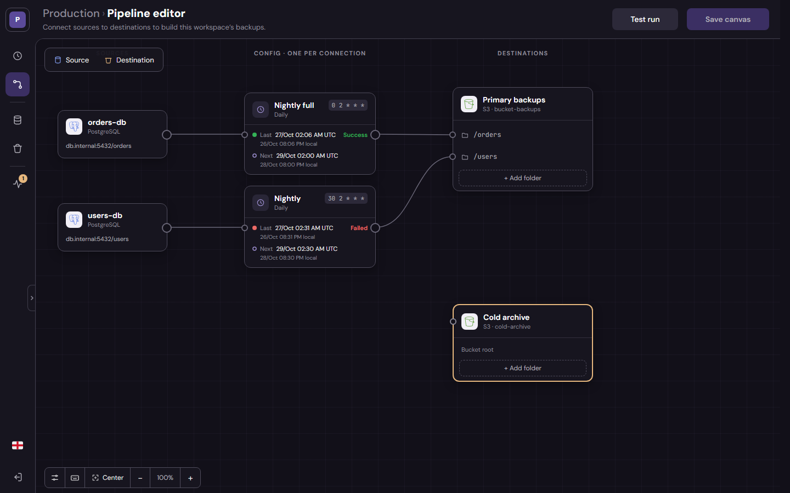
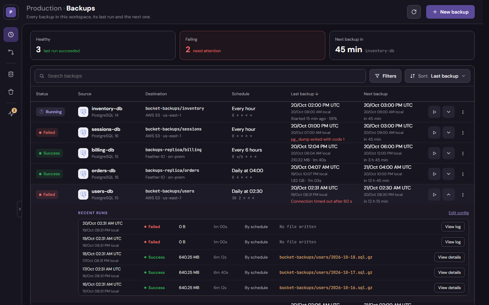
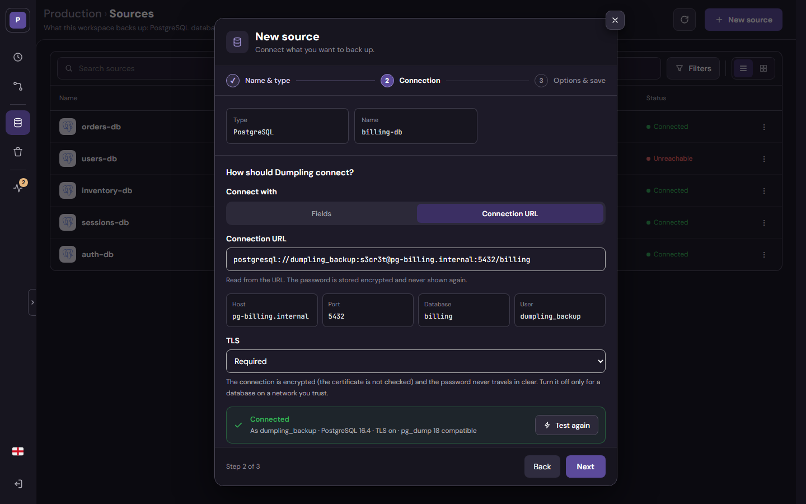
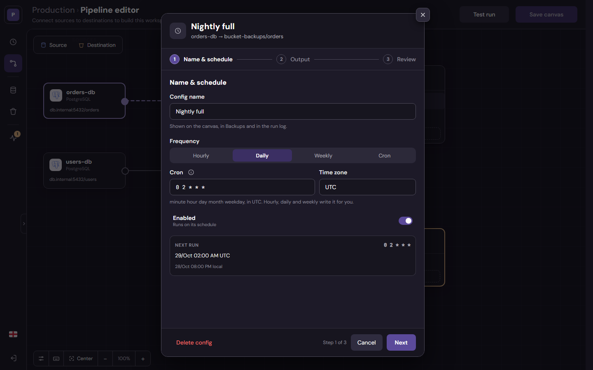
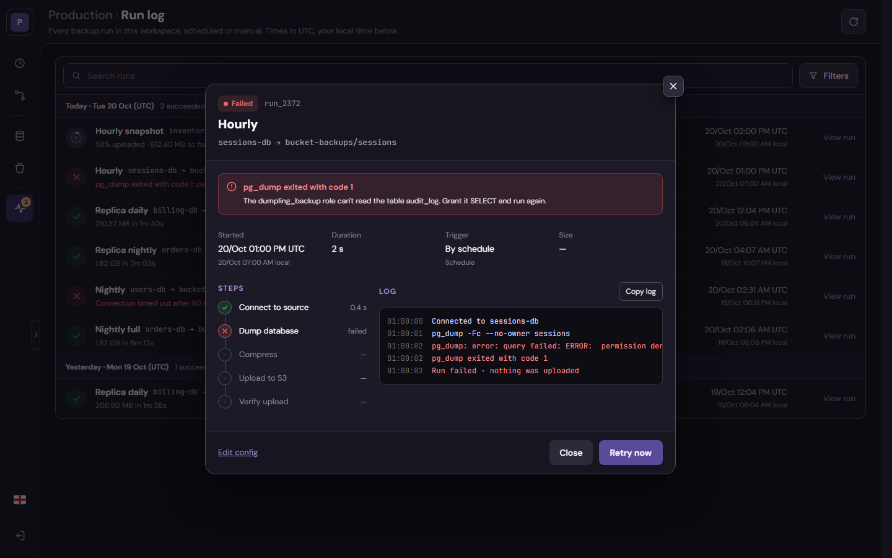

<p align="center">
  <picture>
    <source media="(prefers-color-scheme: dark)" srcset="console/assets/brand/wordmark.svg">
    
  </picture>
</p>

# Dumpling

Self-hosted backups of your databases, on a schedule, to the storage you choose. You draw what
goes where on a canvas (a database, a storage and the backup between them) and Dumpling runs the
dump tool of the database on its schedule and streams the dump to the storage, without touching
the disk. Today it backs up PostgreSQL to S3-compatible storage, and it is built to take more of
both (see [Sources and destinations](#sources-and-destinations)).

- **`service/`**: the backend, in Dart, on [Winter](https://pub.dev/packages/winter). It runs the
  schedules and the backups, keeps its data in SQLite and serves the API and the console.
- **`console/`**: the web console, in Flutter Web. The service serves it: one image, one port.

> **Status: `0.1.0`, the first release.** It backs up and is tested end to end (a real backup
> restored and compared), but it hasn't had long-running production use yet.



## Why Dumpling

> ### Where it comes from
>
> - **None of the backup tools fit.** Some back up only one database or write to only one
    > destination, some have no console, and the console of others is so complex it gets in the way.
> - **Most of them are built to manage thousands of backups**, and that scale makes everything more
    > complex than it needs to be. Dumpling goes the other way: it is made for small and medium
    > projects. It doesn't break under load, but huge volumes are not who it is for.
> - **Hosting is paid by the megabyte.** Tools like Databasus are heavy services; on a small VPS or
    > a platform that bills memory, every megabyte counts.
>
> ### What it is today
>
> Backups that are simple to deploy and to use, without leaving out the common cases: simple
> doesn't mean few features. Several databases to several buckets, on a schedule or on demand,
> with a console that shows how every backup is doing and the log of every run, in a service that
> rests at **~15 MiB of memory**. And the cherry on top: the **canvas**, where backups are set up by
> drawing what goes where.
>
> ### Where it's going
>
> More robust, with more features, and a project people can trust: it backs up the databases of
> its author's own projects, so it will keep being maintained, and it will stay open source
> (Apache 2.0). Next, in 0.2.0: more sources and destinations behind the same contracts (MySQL,
> MongoDB, Google Drive…), retention of old backups, alerts and downloading a backup from the
> console (see [`ROADMAP.md`](ROADMAP.md)). Always keeping its core: **easy to deploy and to use,
> and very lightweight.**

## What it does

|                  |                                                                                                                                    |
|------------------|------------------------------------------------------------------------------------------------------------------------------------|
| **Sources**      | Databases, each dumped with its own tool; today PostgreSQL (up to the `pg_dump` of the image, 18 by default), over TLS by default  |
| **Destinations** | Storages for the dumps, at their root or in folders; today any S3-compatible one (AWS S3, MinIO, feather-io…)                      |
| **Canvas**       | Sources, destinations and the backups between them, connected by hand and saved in one go; a test run checks every flow first      |
| **Backups**      | Cron schedules in UTC and Run now; gzip or none; object keys with placeholders (`{db}/{yyyy}-{MM}-{dd}`); streamed in 16 MiB parts |
| **Monitoring**   | Health of every backup with its last and next run, and a run log with the log of each run                                          |
| **Workspaces**   | Separate canvases for environments, clients or projects                                                                            |
| **Console**      | English and Spanish; times in UTC with the local time next to them                                                                 |

|                                                                   |                                                                      |
|-------------------------------------------------------------------|----------------------------------------------------------------------|
|    |  |
|  |           |

Every screen, its URL and what it calls: [`docs/console.md`](docs/console.md). The whole design, as
a PDF and images: [`docs/design/`](docs/design/README.md).

**What it doesn't do (yet):** restore from the console (it is plain `pg_restore`, see
[`docs/restore.md`](docs/restore.md)), retention of old backups, alerts, the sources and
destinations still planned (below; the console shows them as *Soon*), more than one user,
checking the certificate of a database (`verify-full`). It serves HTTP: put a proxy in front for
TLS, and publish the port only to it (`127.0.0.1:8080:8080`).

### Sources and destinations

Each one is a driver behind the same contract, so adding one doesn't change the rest.

<table>
<tr><th>Sources</th><th>Destinations</th></tr>
<tr>
<td valign="top">

| Database   | Supported |
|------------|:---------:|
| PostgreSQL |     ✅     |
| MySQL      |           |
| MariaDB    |           |
| MongoDB    |           |
| Redis      |           |

</td>
<td valign="top">

| Storage                                    | Supported |
|--------------------------------------------|:---------:|
| S3-compatible (AWS S3, MinIO, feather-io…) |     ✅     |
| Google Drive                               |           |
| Dropbox                                    |           |
| Azure Blob                                 |           |
| SFTP                                       |           |

</td>
</tr>
</table>

## Run it

### With Docker Compose

From the root of the repo, with the four secrets in a `.env` file (see
[`.env.example`](.env.example)) or in the environment of the shell:

```bash
cp .env.example .env      # and fill in the admin user, its password and two long random secrets
docker compose up -d --build
```

- Console and API: <http://localhost:8080>, sign in with `DUMPLING_ADMIN_USER` /
  `DUMPLING_ADMIN_PASSWORD`.
- Its SQLite database lives in the `dumpling-data` volume; the backups, in your buckets.
- `PG_VERSION` in the `.env` chooses the `pg_dump` of the image (it dumps servers of that version or
  older); change it and run `docker compose up -d --build`.

Keep `SECRETS_ENCRYPTION_KEY`: the passwords of the databases and the keys of the buckets are
encrypted with it, and changing it makes them unreadable.

A source connects with TLS unless its **TLS** setting is turned off (`ssl_mode` `disable`): a
PostgreSQL without TLS, like the one of a plain `postgres` container, needs it off.

### With Docker, the image alone

```bash
docker build -t dumpling --build-arg PG_VERSION=18 .
docker run -p 8080:8080 -v dumpling-data:/data \
  -e DUMPLING_ADMIN_USER=… -e DUMPLING_ADMIN_PASSWORD=… \
  -e JWT_SECRET=… -e SECRETS_ENCRYPTION_KEY=… dumpling
```

### Locally

Both packages pin their Flutter/Dart version with [FVM](https://fvm.app) (`.fvmrc`).

```bash
# Service, on port 8080 (PORT changes it); pg_dump from the PATH unless PG_DUMP_PATH says
cd service
fvm dart pub get
DUMPLING_ADMIN_USER=admin DUMPLING_ADMIN_PASSWORD=some-long-password \
JWT_SECRET=some-jwt-secret SECRETS_ENCRYPTION_KEY=some-secrets-key DATA_PATH=./data \
fvm dart run lib/main.dart

# Console, apart (it reads SERVICE_URL from web/env.js)
cd console
echo "window.env = { SERVICE_URL: 'http://localhost:8080' };" > web/env.js
fvm flutter pub get
fvm flutter run -d chrome --web-port=8081
```

## Configuration

| Variable                                                             | Default                                    | What it is                                                                   |
|----------------------------------------------------------------------|--------------------------------------------|------------------------------------------------------------------------------|
| `DUMPLING_ADMIN_USER`                                                | (required)                                 | The user that signs in to the console                                        |
| `DUMPLING_ADMIN_PASSWORD`                                            | (required)                                 | Its password; a warning below 12 characters                                  |
| `JWT_SECRET`                                                         | (required)                                 | Signs the sessions; rotating it signs everyone out                           |
| `SECRETS_ENCRYPTION_KEY`                                             | (required)                                 | Encrypts the stored credentials; changing it makes them unreadable           |
| `PORT`                                                               | `8080`                                     | Port of the API and the console                                              |
| `DATA_PATH`                                                          | `data` (`/data`)                           | Folder of the SQLite database                                                |
| `PG_DUMP_PATH`                                                       | `pg_dump` (image: the one of `PG_VERSION`) | The `pg_dump` the backups run                                                |
| `TRUSTED_PROXIES`                                                    | `0`                                        | Proxies of your own in front (`X-Forwarded-For`, from private addresses)     |
| `RATE_LIMIT_REQUESTS`, `RATE_LIMIT_WINDOW_SECONDS`                   | `600`, `60`                                | Requests per IP and window; `0` disables it                                  |
| `LOGIN_MAX_FAILURES`, `LOGIN_LOCK_SECONDS`, `LOGIN_FAILURE_DELAY_MS` | `10`, `900`, `1000`                        | Failed logins that lock an IP, for how long, and the wait after each failure |
| `LOG_LEVEL`, `LOG_FORMAT`                                            | `info`, readable                           | `LOG_FORMAT=json` writes one JSON object per line                            |

## Restoring

A backup is one file in your bucket: `pg_restore` (custom format) or `psql` (plain SQL) restores it.
The Run log shows where each run wrote; [`docs/restore.md`](docs/restore.md) has the steps, tested
against real backups.

## Documentation

- [`docs/api.md`](docs/api.md): the HTTP API, with real requests and responses.
- [`docs/console.md`](docs/console.md): a tour of the console, screen by screen, with the calls each
  one makes; and [`docs/design/`](docs/design/README.md), its design as a PDF and images.
- [`docs/brand.md`](docs/brand.md): the logo, what it means, its versions, colors and type, and the
  presentation images (files in [`docs/design/brand/`](docs/design/brand)).
- [`docs/restore.md`](docs/restore.md): restoring a backup, step by step.
- [`service/README.md`](service/README.md) and [`console/README.md`](console/README.md): running and
  testing each package, and the end-to-end test.
- [`SECURITY.md`](SECURITY.md): the security model and how to deploy it safely (a read-only
  database role, a write-only bucket key).
- [`DECISIONS.md`](DECISIONS.md): the non-obvious design decisions and why.
- [`ROADMAP.md`](ROADMAP.md): where it stands and what comes next.
- [`CONTRIBUTING.md`](CONTRIBUTING.md).

## License

[Apache License 2.0](LICENSE).
