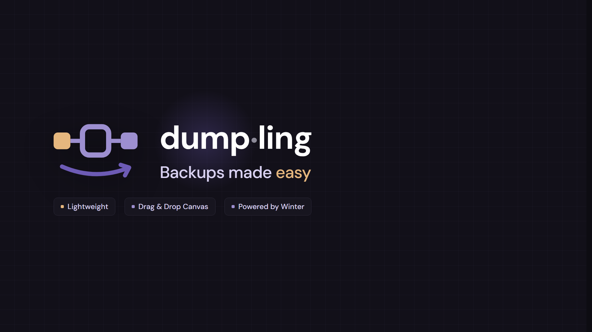
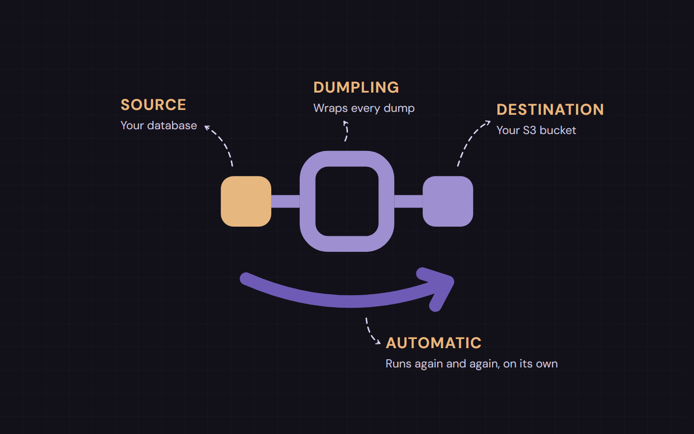
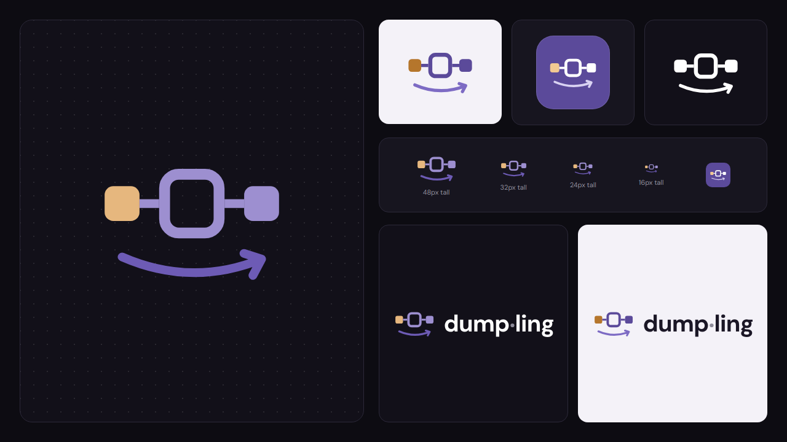
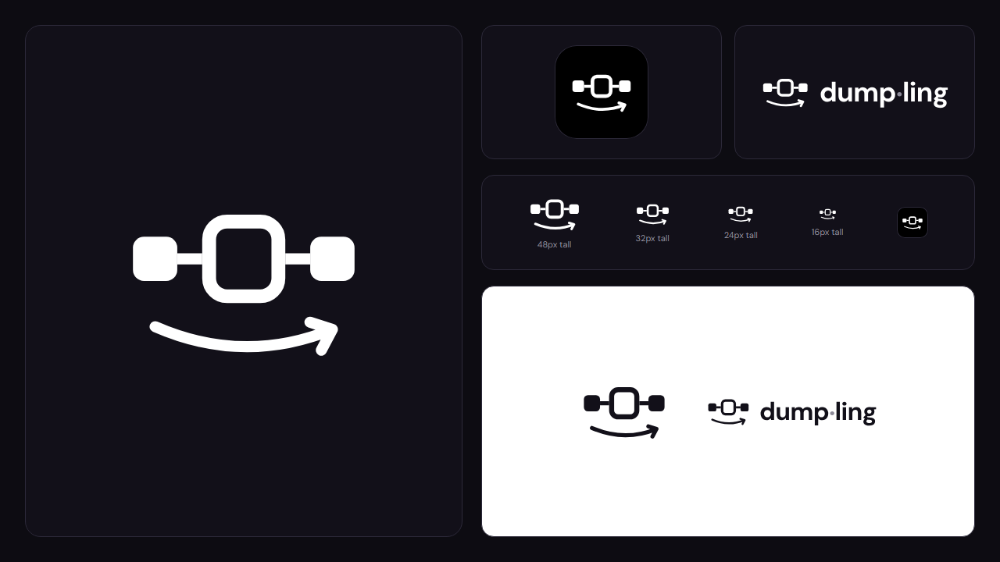
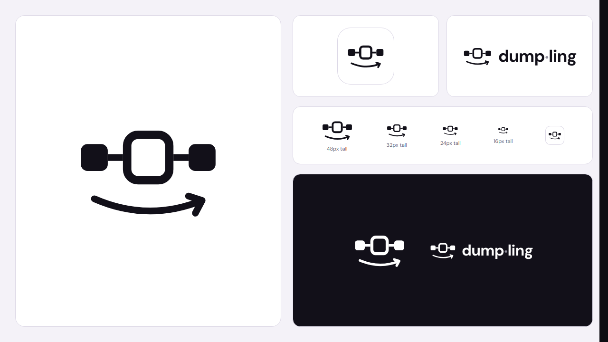
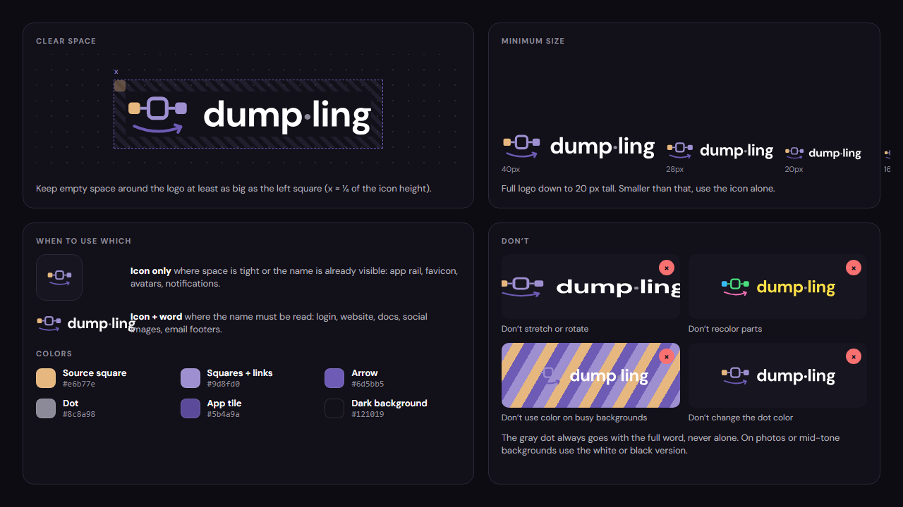

# The brand

The visual identity of Dumpling: the icon, the wordmark, their colors and type, and the images
used to present the project. Everything here comes from the **Logo** page of the design canvas and
is exported to [`design/brand/`](design/brand) (see
[Keeping it up to date](#keeping-it-up-to-date)).

## What the logo means

The icon draws what Dumpling does, left to right:

| Part                            | What it is                                                  |
|---------------------------------|-------------------------------------------------------------|
| The amber square, on the left   | The **source**: your database                               |
| The violet ring in the middle   | **Dumpling**, which wraps every dump on its way             |
| The violet square, on the right | The **destination**: your S3 bucket                         |
| The lines between them          | The connection drawn on the canvas, source → config → bucket |
| The arrow underneath            | **Automatic**: it runs again and again, on its own          |

It is also a dumpling seen from above, and the canvas of the console in miniature.

## The icon

  
  &nbsp;&nbsp;
  

Drawn on an 88 × 62 grid (the `viewBox` of the SVGs):

| Part              | Measures                                                                                     |
|-------------------|----------------------------------------------------------------------------------------------|
| Source square     | 16 × 16 at 4, 15, radius 4                                                                   |
| Links             | Strokes of 4 from the squares to the ring (20 → 29 and 59 → 68, at y 23)                     |
| Ring              | 25 × 27 at 31.5, 9.5, radius 6.5, stroke 5, no fill                                          |
| Destination square | 16 × 16 at 68, 15, radius 4                                                                 |
| Arrow             | A curve from 12, 47.5 to 76, 48.5 through 44, 61.5 and its head, stroke 4, round caps and joins |

### Versions

| File                                                       | Colors                                                    | Use it on                                          |
|------------------------------------------------------------|-----------------------------------------------------------|----------------------------------------------------|
| [`icon.svg`](design/brand/icon.svg)                        | Amber `#e6b77e`, violet `#9d8fd0`, arrow `#6d5bb5`        | Dark backgrounds: the main one                     |
| [`icon-light.svg`](design/brand/icon-light.svg)            | Amber `#b5762c`, violet `#5b4a9a`, arrow `#7d6bc4`        | Light backgrounds                                  |
| [`icon-tile.svg`](design/brand/icon-tile.svg)              | The icon in light tones on a violet `#5b4a9a` square, radius 28 of 120 | App icons, avatars, favicons            |
| [`icon-white.svg`](design/brand/icon-white.svg)            | All white                                                 | Photos and mid-tone or busy backgrounds            |
| [`icon-black.svg`](design/brand/icon-black.svg)            | All `#121019`                                             | The same, when the background is light             |

The white and black versions, at every size and on a light background:

|                                                        |                                                        |
|--------------------------------------------------------|--------------------------------------------------------|
|      |      |

## The wordmark

**dump·ling** in DM Sans Bold, white on dark (`#1b1726` on light), with a **gray dot** (`#8c8a98`)
between *dump* and *ling*. The full logo is the icon followed by the word. The console has both as
SVG: [`wordmark.svg`](../console/assets/brand/wordmark.svg) (icon and word, the one the README
shows) and [`name.svg`](../console/assets/brand/name.svg) (the word alone).

| Text          | Font            | Color                                           |
|---------------|-----------------|-------------------------------------------------|
| Wordmark      | DM Sans Bold    | `#ffffff`, the dot `#8c8a98`                    |
| Tagline       | DM Sans Medium  | `#d9d2f2`, *easy* in amber `#e6b77e`            |
| Tags          | DM Sans Medium  | `#d9d2f2` on `#17151f`, a small amber or violet square before each |
| Code          | JetBrains Mono  | The console's: object keys, crons, hosts        |

**Tagline:** *Backups made easy.*
**Tags:** *Lightweight · Drag & Drop Canvas · Powered by Winter*.

## Colors

| Use                                 | Color     |
|-------------------------------------|-----------|
| Source square, accent (*easy*)      | `#e6b77e` |
| Squares and links, soft violet      | `#9d8fd0` |
| Arrow                               | `#6d5bb5` |
| App tile, the console's main button | `#5b4a9a` |
| The dot of the wordmark             | `#8c8a98` |
| Background of every image           | `#121019` |
| Cards and panels                    | `#17151f` |
| Borders                             | `#2c2939` |

The images add a grid of 48 px over the background (`#9d8fd0` at 5 %), like the canvas of the
console, and a soft violet and amber glow behind the logo.

## Using it

- **Clear space:** keep empty space around the logo at least as big as the source square (¼ of the
  icon's height).
- **Minimum size:** the full logo down to 20 px tall; smaller than that, the icon alone.
- **Which one:** the icon alone where space is tight or the name is already visible (the rail, a
  favicon, an avatar, a notification); icon and word where the name must be read (the sign-in,
  the docs, a website, social images).
- **Don't** stretch or rotate it, recolor its parts, put the color version on a busy background,
  or change the color of the dot. The dot always goes with the full word, never alone. On photos
  or mid-tone backgrounds use the white or black version.

## Presentation images

In [`design/brand/images/`](design/brand/images).

### Identity

**1920 × 1080.** The icon, the wordmark, the tagline and the tags on the grid. For the start of a
talk, a video or a post, and the base of the sign-in screen (its left half is this image at 60 %).

### Manifesto

**1080 × 1080**, a square post: *Dumpling isn't just a backup service. It's a calmer way to keep
your data safe.*

### What the logo means

**1440 × 900.** The icon with each of its parts named (above).

## Keeping it up to date

The canvas is the source (its **Logo** page): https://claude.ai/artifact/8ZG7z26F5hn1KMsV2a1wvN.
When the brand changes, change the canvas, then:

1. If the icon changed, update its SVGs in `design/brand/` by hand (the same 88 × 62 grid, the
   values of the `Logo · Main` artboard), the console's
   [`wordmark.svg`](../console/assets/brand/wordmark.svg) and the measures and colors above.
2. Regenerate the images with the export of the design ([`design/README.md`](design/README.md)):
   it renders the artboards listed in `BRAND`.
3. Look at the result and commit it with the change.
