# The console

A tour of the Dumpling web console: each screen, its URL and what it does. The images come from the
design of the console ([`design/`](design/README.md)); the console itself speaks English and
Spanish (the flag in the rail).

The service serves the console on its own port (`http://localhost:8080` by default), on the same
origin as the API. The console uses hash URLs, so the screen and its state go after `#`:
`http://localhost:8080/#/workspaces/production/runs?status=failed`. Every screen has its own URL, so
it can be bookmarked, shared, reloaded and reached with back and forward; a detail's URL opens its
dialog over its screen, and leaving the URL closes it.

Each screen ends with **Behind it**: the calls it makes to the service, explained with examples in
[`api.md`](api.md). The console talks to the service only through them, under `/api`, with the
token of the sign-in and its language in `Accept-Language` (the service answers its errors in it).

Times are shown in UTC, the one the service runs on, with the local time smaller under them.

## Sign in

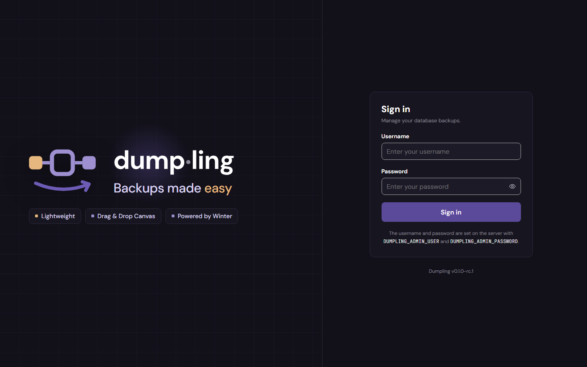

**URL:** `/#/login` (with `?from=` the page asked for before signing in, opened again afterwards)

The brand on the left (the icon, *Backups made easy* and its tags) and the form on the right: the
user and password of the admin, set on the service with `DUMPLING_ADMIN_USER` and
`DUMPLING_ADMIN_PASSWORD` (the hint under the form names them). While it signs in, only the form's
side is blurred under a spinner. A wrong password shows the service's error inside the form; after
several wrong attempts in a row the service locks the IP for a while. The browser's password
manager may offer to save the password; the console never stores it, only the token, valid for 12
hours. In a window narrower than 900 px the brand goes above the form.

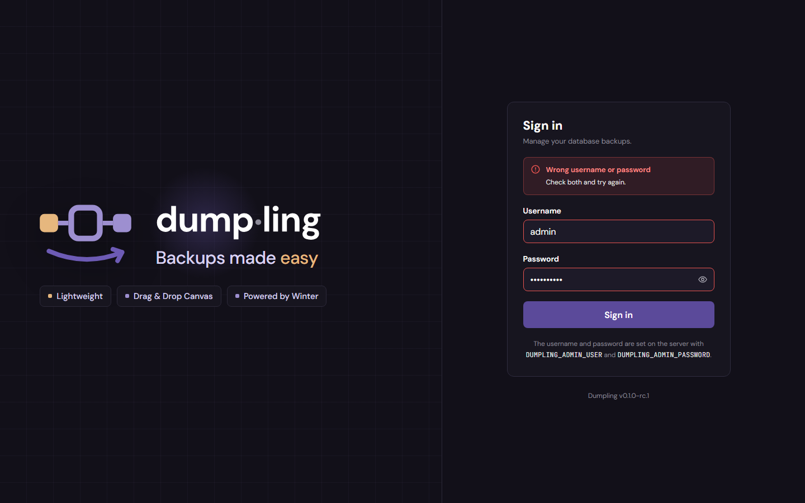

When the token expires, the screen you were on stays (an unsaved canvas too) under a dialog that
signs in again, or goes to this page:

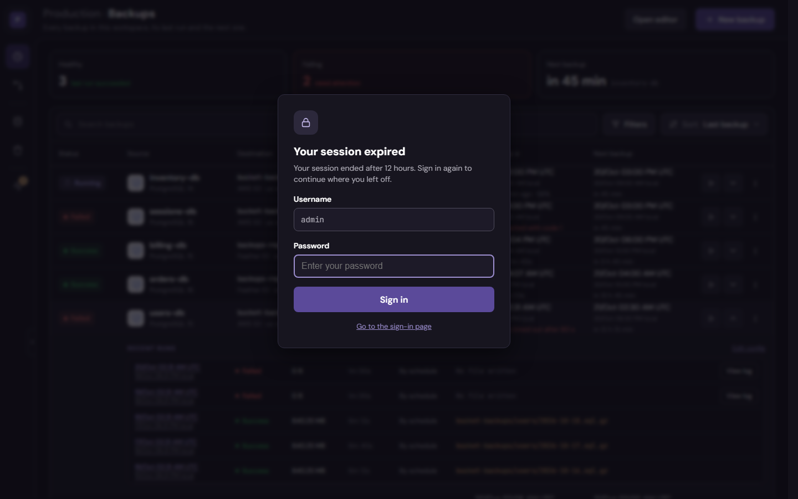

**Behind it:** [`POST /api/auth/login`](api.md#log-in) with `{"username", "password"}`, which
answers the token every other call sends as `Authorization: Bearer …`. Signing out only forgets it.

## Navigation

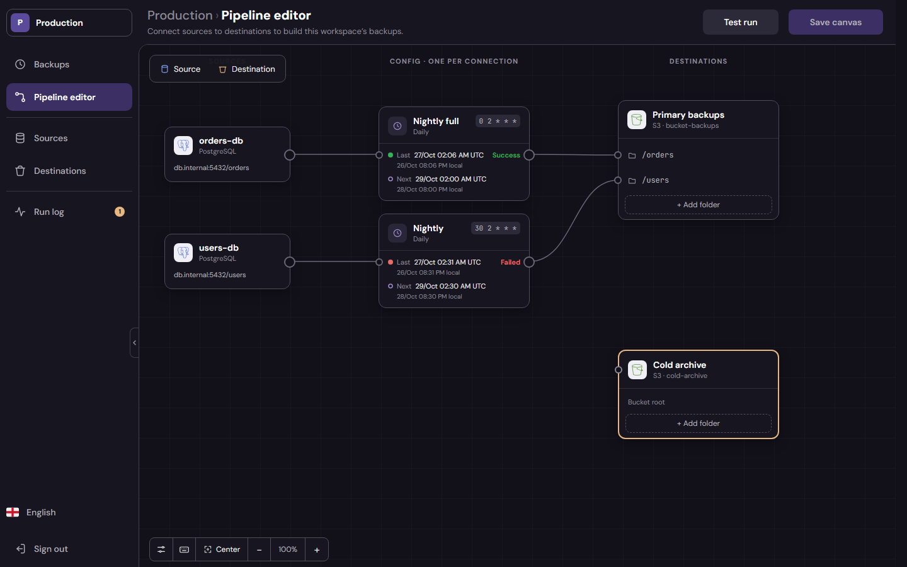

The rail on the left: at the top the **current workspace**, which opens the list of workspaces;
then **Backups** and the **Pipeline editor**, **Sources** and **Destinations**, and the **Run log**,
with the number of failing backups. At its foot the **language** and **Sign out**. The notch in the
middle of its edge expands it to show the names, and folds it again.

**Behind it:** the failing count comes from the statistics of the workspace
([`GET /api/workspaces`](api.md#list-workspaces)).

## Workspaces

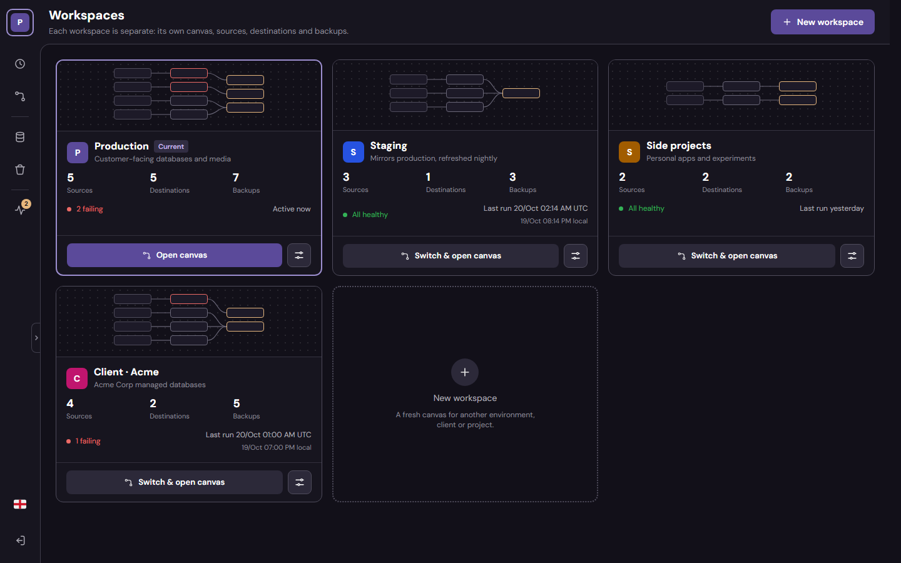

**URL:** `/#/workspaces`

Separate canvases for environments, clients or projects. Each card shows a preview of its configs,
its counts (sources, destinations, backups), its health (healthy, or how many fail) and its last
run; **Switch & open canvas** enters it and the button next to it opens its settings. Inside a
workspace, its slug is in the URL (`/#/workspaces/production/…`), so a link opens it; the last one
opened is remembered.

**New workspace** asks for a name, an optional description and a color. The slug comes from the
name (`Test workspace` → `test-workspace`), is unique and doesn't change on a rename.

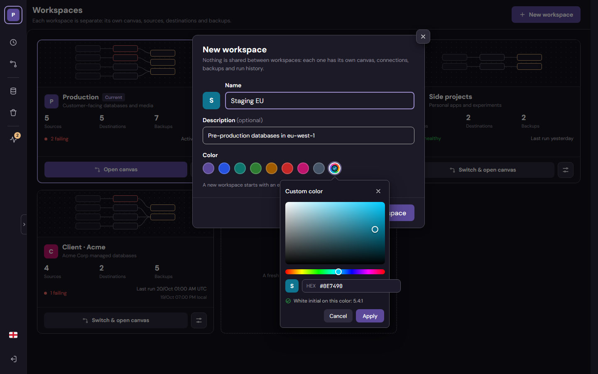

### Settings

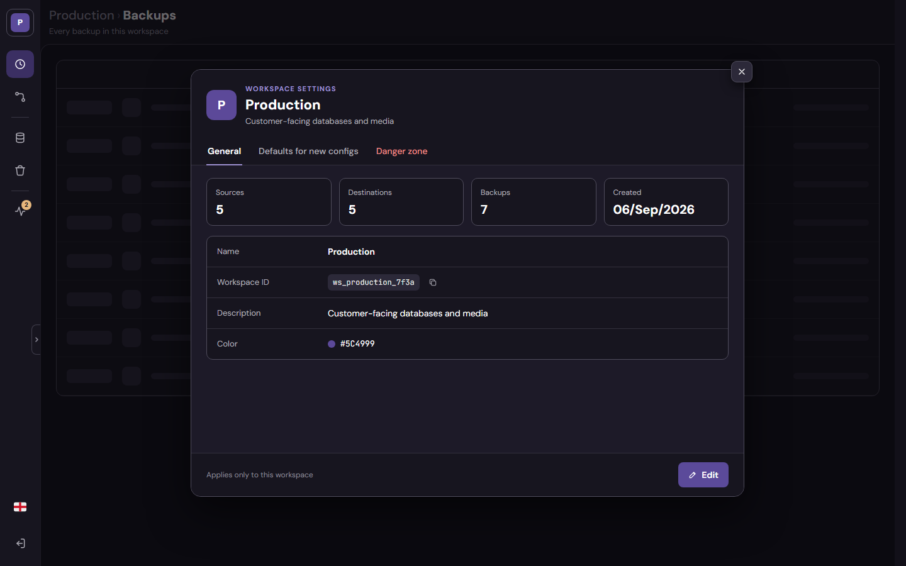

A dialog over the list, in tabs: **General** (name, description, color), **Defaults** (the
schedule, compression and object key a new config starts with) and **Delete**. Deleting asks you to
type the name of the workspace and says what goes with it: its sources, destinations, configs and
runs. The files already in the buckets stay.

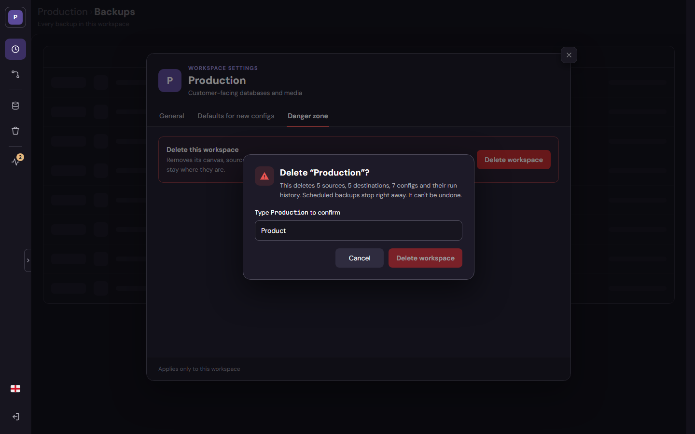

**Behind it:** [`GET /api/workspaces`](api.md#list-workspaces) for the cards (with their
statistics), [`POST /api/workspaces`](api.md#create-a-workspace) to create one,
[`PUT /api/workspaces/{slug}`](api.md#edit-a-workspace) to edit it and its defaults, and
[`DELETE /api/workspaces/{slug}`](api.md#delete-a-workspace) to delete it.

## Pipeline editor

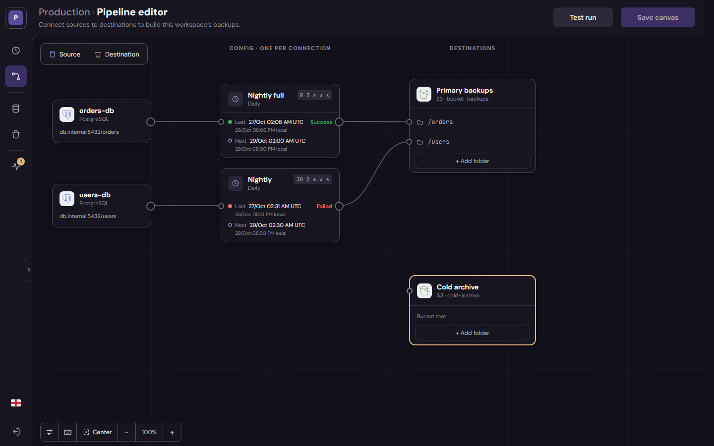

**URL:** `/#/workspaces/{slug}/canvas`

The heart of Dumpling: **sources** on the left, **destinations** on the right and between them a
**config** for each backup. Drag from the port of a source to a destination (its root) or to one of
its folders, and a config is created between them. Each config node shows its name, its schedule,
its last run (with its result) and its next one, in UTC with the local time under them; each
source and destination shows the logo of its type.

The toolbar at the top left places on the canvas a source or a destination that isn't on it yet
(or goes to create one). A folder can be added to a bucket from the canvas too. Right click opens
the menu of the canvas; hold Space and drag to move it (or the arrow keys), Ctrl and scroll zooms,
F centers; click a connection and press Delete to remove it; Escape closes a config. The buttons at the bottom left center it and zoom, and
show the shortcuts.

Everything is edited in the console and saved whole with **Save canvas**, enabled only with
changes. Only complete flows are saved: a config without a source or a destination is left out.
Leaving the canvas (another screen, another workspace, closing or reloading the tab, signing out)
with changes not saved asks first. **Test run** checks every complete flow without backing anything
up: each source connects and `pg_dump` can dump it, each destination takes a write in its folders.

### A config

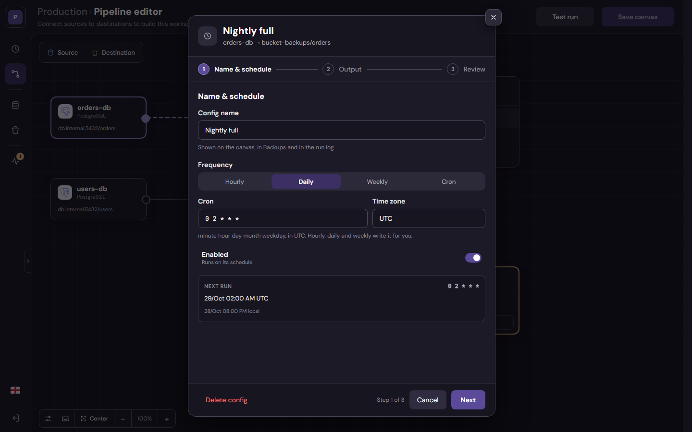

Opened from its node (its pencil, or double click), in three steps:

1. **Name & schedule:** the name, the frequency (hourly, daily, weekly or a cron, in UTC) and
   whether it is enabled, with the next run it gives. An empty cron takes the workspace's.
2. **Output:** the **object key**, the name of the file in the bucket, relative to the folder it
   writes to and without extension (the service adds `.dump` or `.sql`, and `.gz` with gzip). The
   info icon next to it lists its placeholders: `{yyyy}`, `{MM}`, `{dd}`, `{HH}`, `{mm}` (the start
   of the run, in UTC), `{db}` (the database) and `{run_id}` (different every run; without it, two
   backups with the same key overwrite each other). Then the **compression**, gzip or none, with a
   warning when gzip goes on top of a custom dump, already compressed.
3. **Review:** everything chosen and the name the next run writes.

**Run now**, on the node, runs the saved config for real, then follows it until it ends: its node
shows it and a notice says the size or the error. A name too long to read on the canvas gets a
warning under its field, which doesn't block saving.

### An empty workspace

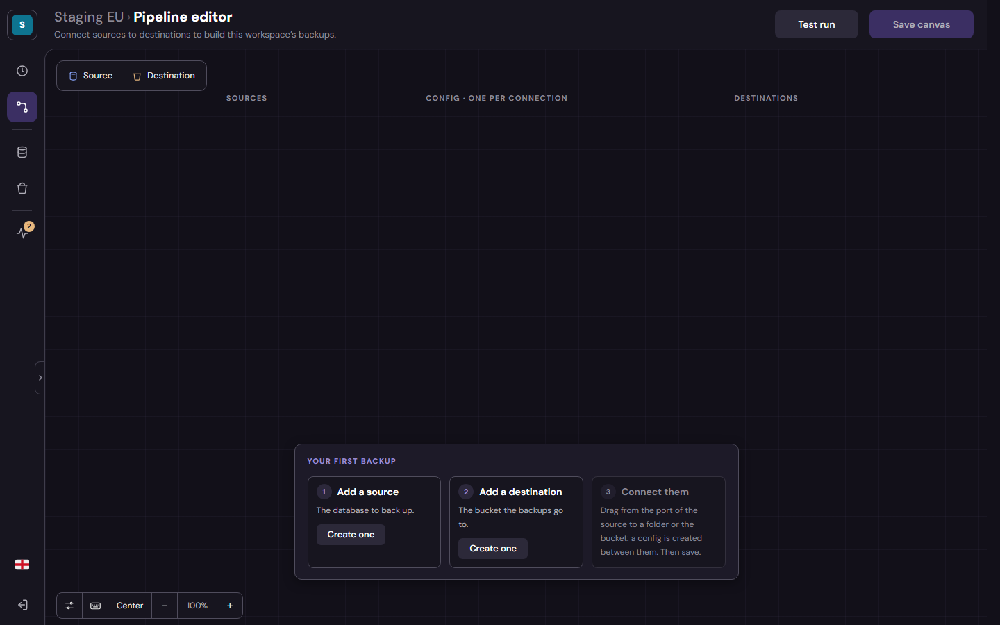

Until its first config, a guide in three steps: add a source, add a destination, connect them.

**Behind it:**

| Action                                      | Call                                                                                                       |
|---------------------------------------------|------------------------------------------------------------------------------------------------------------|
| Load the canvas                             | [`GET /api/workspaces/{slug}/canvas`](api.md#get-the-canvas)                                               |
| Save it, whole                              | [`PUT /api/workspaces/{slug}/canvas`](api.md#save-the-canvas) (new nodes with `new_…` ids, mapped in the answer) |
| Run now, and follow the run                 | [`POST /api/workspaces/{slug}/configs/{id}/run`](api.md#run-now), then [`GET /api/workspaces/{slug}/runs/{id}`](api.md#a-run-and-its-log) every 2 seconds |
| [Test run](api.md#test-run)                 | [`POST /api/workspaces/{slug}/sources/{id}/test`](api.md#test-a-saved-source) for each source, and [`POST /api/workspaces/{slug}/destinations/test`](api.md#test-a-destination-before-saving) for each destination with the folders of the canvas |

## Backups

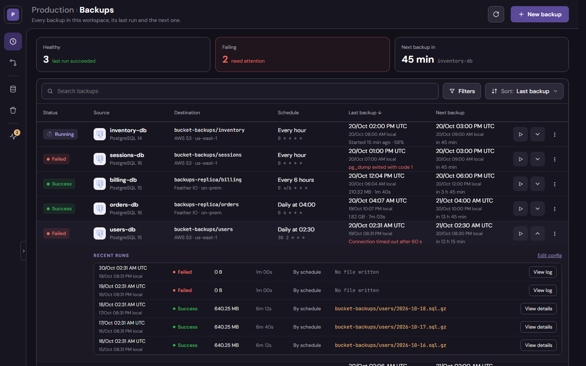

**URL:** `/#/workspaces/{slug}/backups`; a run of a backup: `/#/workspaces/{slug}/backups/runs/{id}`

Where a workspace opens. At the top, its health: how many backups are healthy, how many fail or are
paused, and when the next one runs. Below, every config with its source and destination, schedule, last run
(when, result, size, or the error under the date) and next run, with **Run now** on each row.

|                                                     |                                                 |
|-----------------------------------------------------|-------------------------------------------------|
| 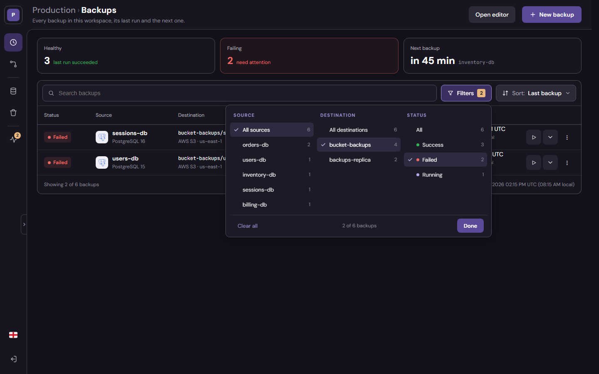   | 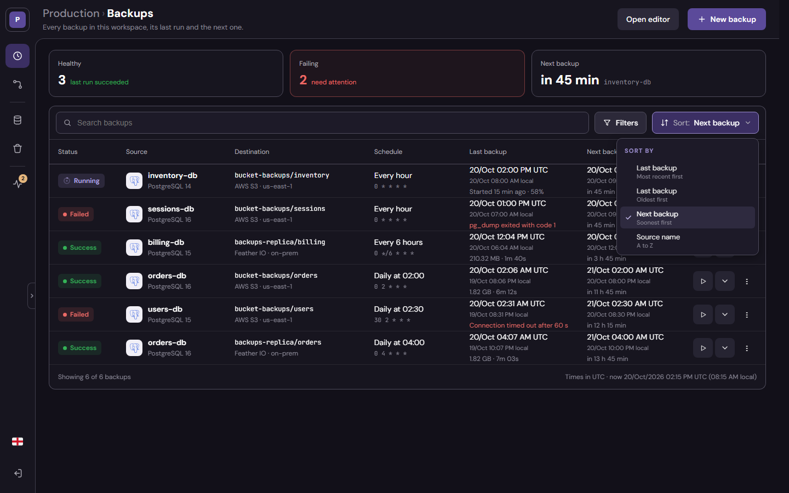     |
| **Filters** by status, source and destination, and a search | **Sort** by the last backup (newest or oldest first), the next one or the source name |

A row opens its recent runs; each one opens its details, the same as in the run log.

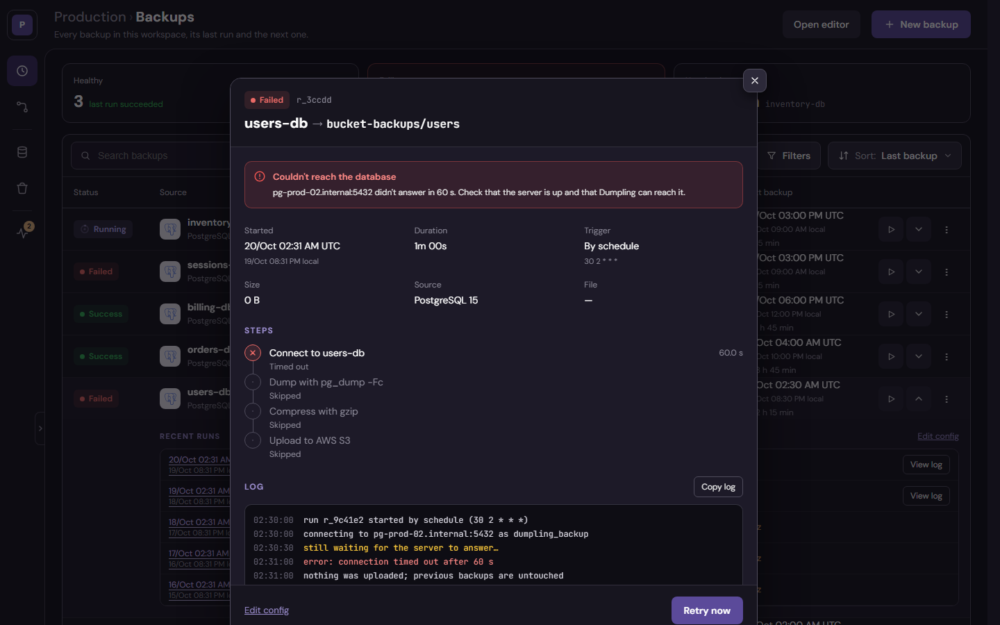

**Behind it:** [`GET /api/workspaces/{slug}/configs`](api.md#list-configs) for the rows (each with
its `last_run` and `next_run`), [`GET /api/workspaces/{slug}/runs?config={id}`](api.md#run-log)
for the recent runs of one, [`GET /api/workspaces/{slug}/runs/{id}`](api.md#a-run-and-its-log) for a run, and
[`POST /api/workspaces/{slug}/configs/{id}/run`](api.md#run-now) for Run now.

## Sources

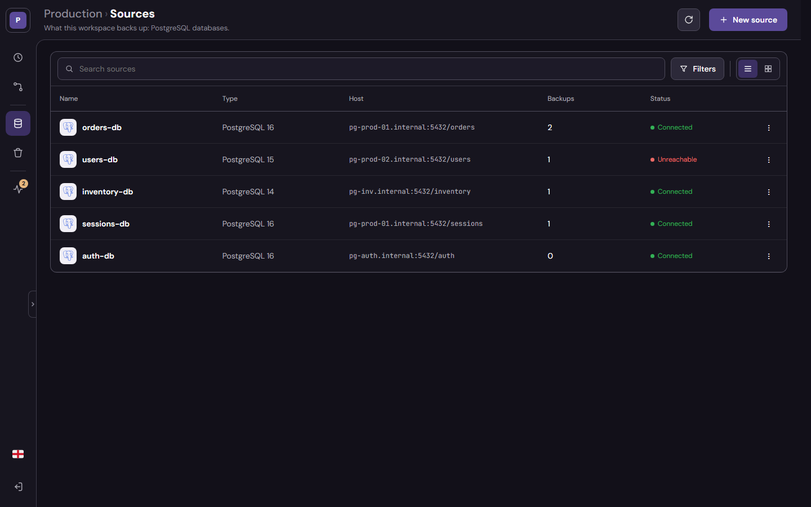

**URL:** `/#/workspaces/{slug}/sources`; a source: `/#/workspaces/{slug}/sources/{id}`

The databases this workspace backs up, as a list or as cards, with a search and a filter by type:
each one's name, type and server version, host, how many backups use it and the result of its last
connection check.

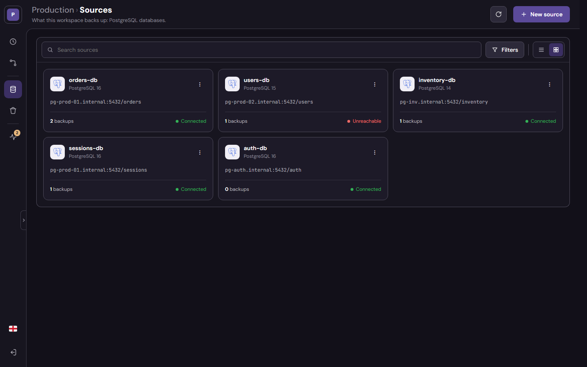

### New source

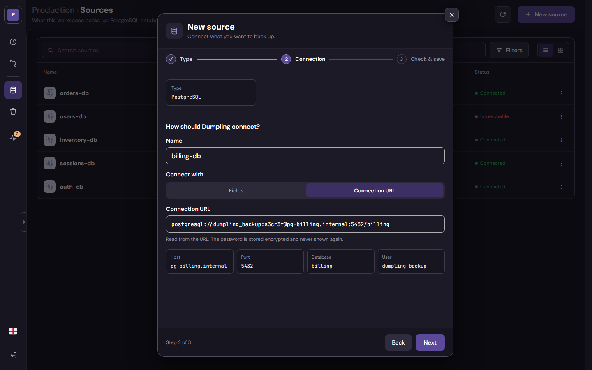

A dialog in three steps, as tall as the screen; each step starts with what the steps before chose.

1. **Type:** PostgreSQL. MySQL, MariaDB, MongoDB and Redis are shown as *Soon*.
2. **Connection:** a name, and the connection by fields (host, port, database, user, password) or by
   a connection URL, which the console reads to show its parts (`sslmode` in it is understood). The
   password is stored encrypted and never shown again; editing, an empty password keeps the saved
   one. Use a read-only role.
3. **Check & save:** the summary, the dump format (custom, `pg_dump -Fc`, or plain SQL), TLS (on by
   default; off only for a database on a network you trust, with a warning) and the connection
   test, which the service runs, never the browser, so the database can be in its internal network.
   It also says whether the `pg_dump` of the image can dump that server's version.

### Its options

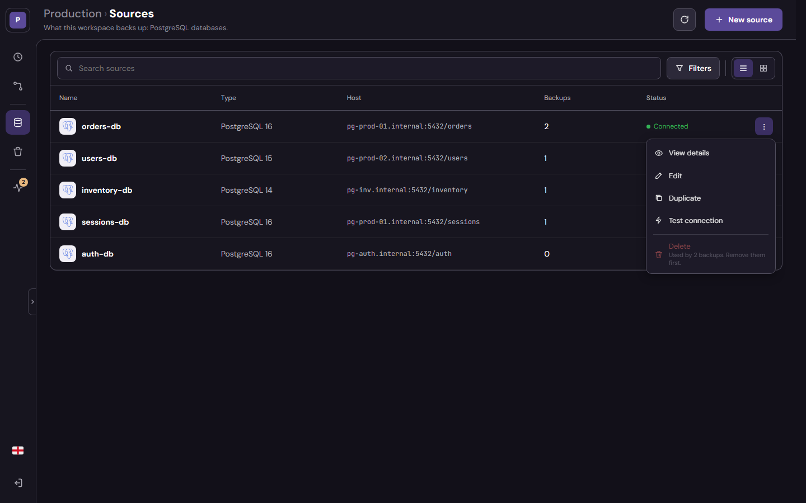

View details, edit, duplicate (without the password), test the connection again, or delete it,
only when no backup uses it (the menu says how many do):

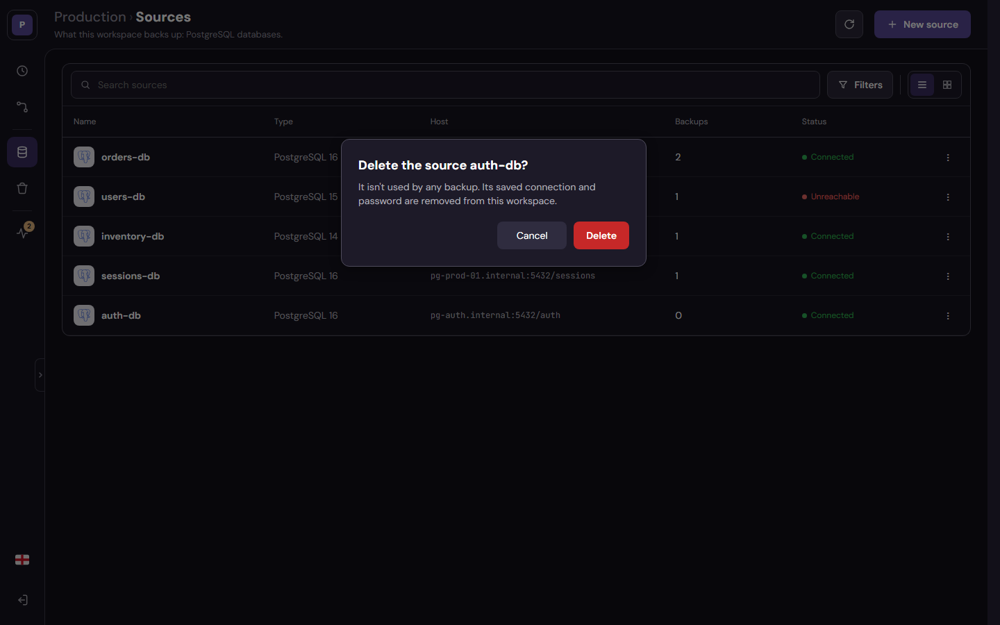

The detail shows the backups that dump it (with their schedule, last and next run), the last check
and the connection:

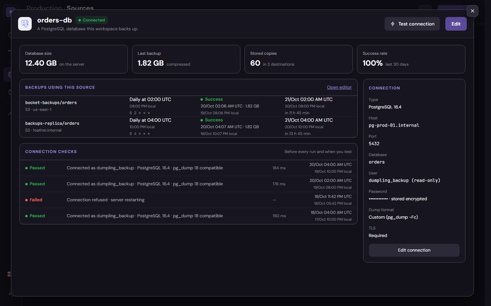

**Behind it:**

| Action                       | Call                                                                                                     |
|------------------------------|----------------------------------------------------------------------------------------------------------|
| The types of the first step  | [`GET /api/source-types`](api.md#types-of-sources-and-destinations)                                                           |
| The list                     | [`GET /api/workspaces/{slug}/sources`](api.md#list-sources)                                              |
| Test the form, before saving | [`POST /api/workspaces/{slug}/sources/test`](api.md#test-a-source-before-saving) (`?source={id}` editing: the saved password) |
| Create                       | [`POST /api/workspaces/{slug}/sources`](api.md#create-a-source)                                          |
| Edit                         | [`PUT /api/workspaces/{slug}/sources/{id}`](api.md#edit-a-source)                                      |
| Test a saved one             | [`POST /api/workspaces/{slug}/sources/{id}/test`](api.md#test-a-saved-source)                            |
| Delete                       | [`DELETE /api/workspaces/{slug}/sources/{id}`](api.md#delete-a-source)                                   |
| The backups of the detail    | [`GET /api/workspaces/{slug}/configs`](api.md#list-configs)                                              |

## Destinations

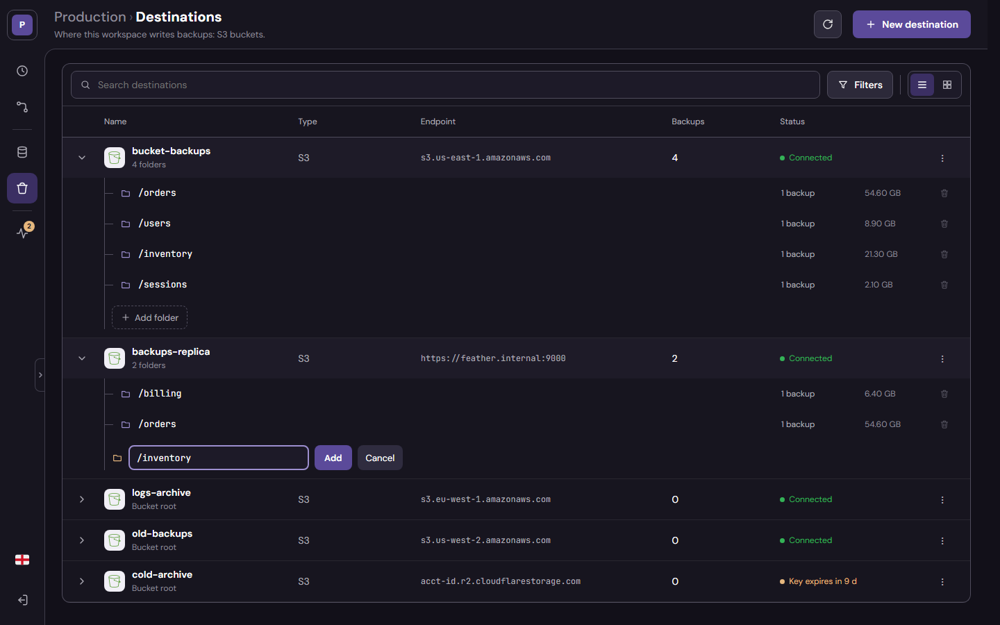

**URL:** `/#/workspaces/{slug}/destinations`; a destination: `/#/workspaces/{slug}/destinations/{id}`

The buckets this workspace writes to, as a list or as cards, with a search and a filter by type. A
row opens the folders of its bucket, to add or delete them there: with at least one folder, each
folder is a connection point on the canvas and the root of the bucket is not; with none, the root
is the only one. A folder a backup writes to can't be deleted.

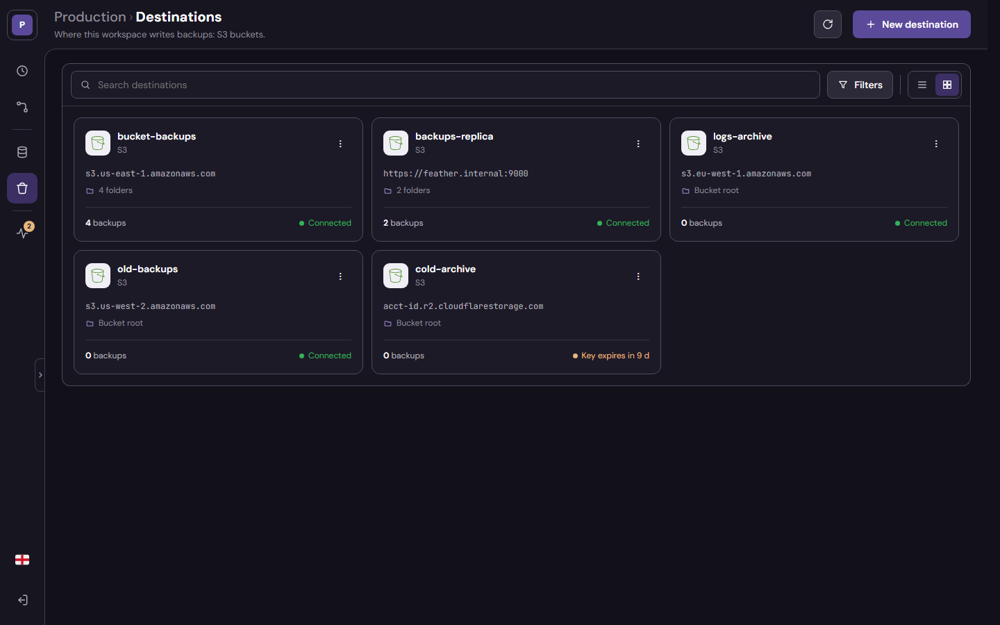

### New destination

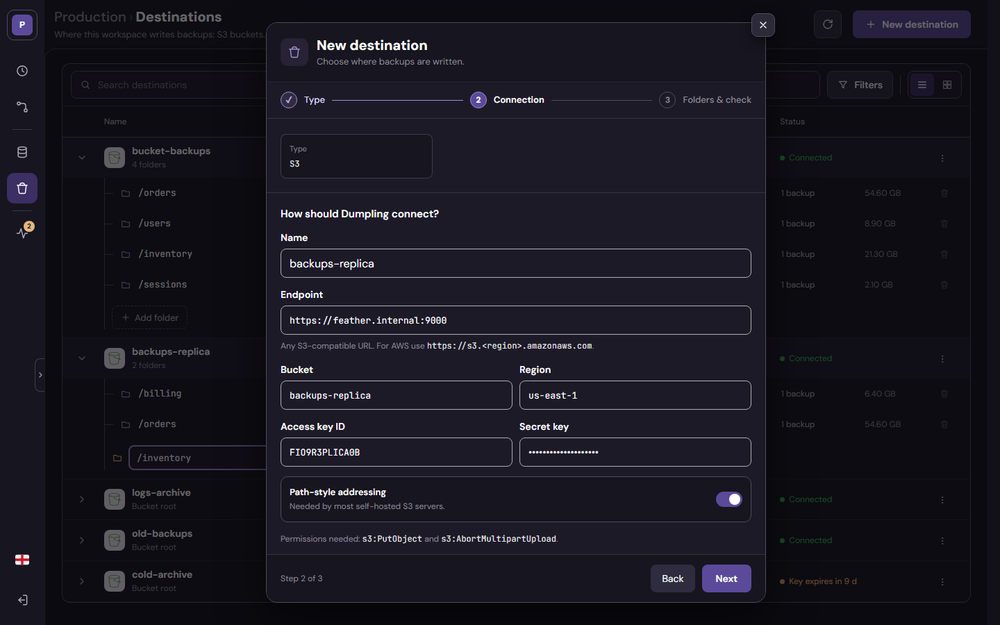

The same dialog in three steps:

1. **Type:** S3, any S3-compatible storage. Google Drive, Azure Blob, Dropbox and SFTP are shown as
   *Soon*.
2. **Connection:** a name, the endpoint (for AWS, `https://s3.<region>.amazonaws.com`), the bucket,
   the region (optional), the access key and its secret key (stored encrypted, never shown again),
   and path-style addressing, needed by most self-hosted S3 servers. The key needs `s3:PutObject`
   and `s3:AbortMultipartUpload`.
3. **Folders & check:** the summary, the folders (optional) and the connection test, which starts
   a multipart upload in each folder and aborts it, so it proves the key, the bucket and the write
   permission there without leaving anything behind.

### Its options

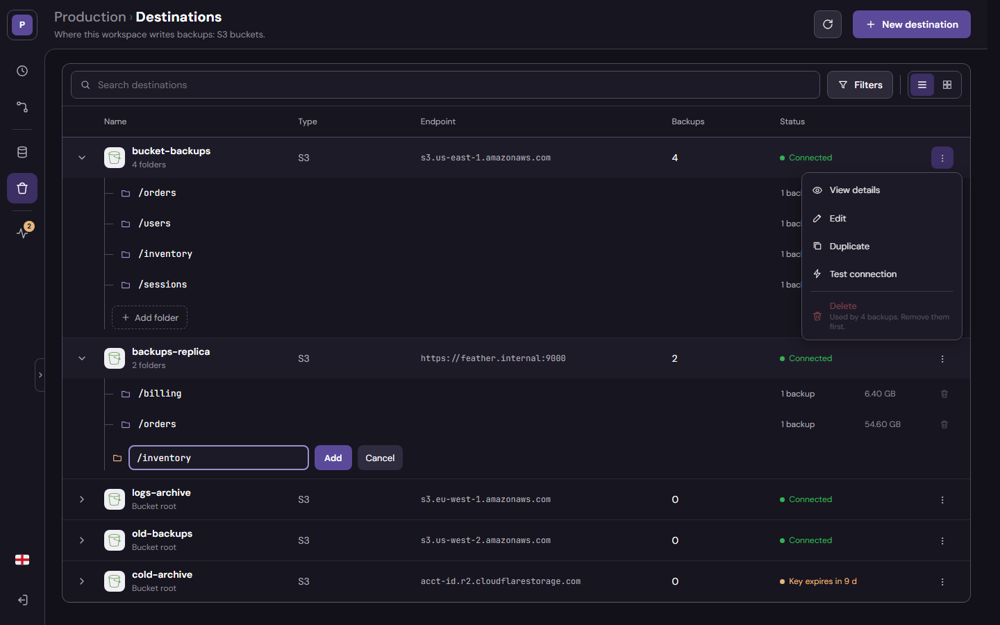

The same as a source: view details, edit, duplicate (without the secret key), test, or delete, only
when no backup writes to it.

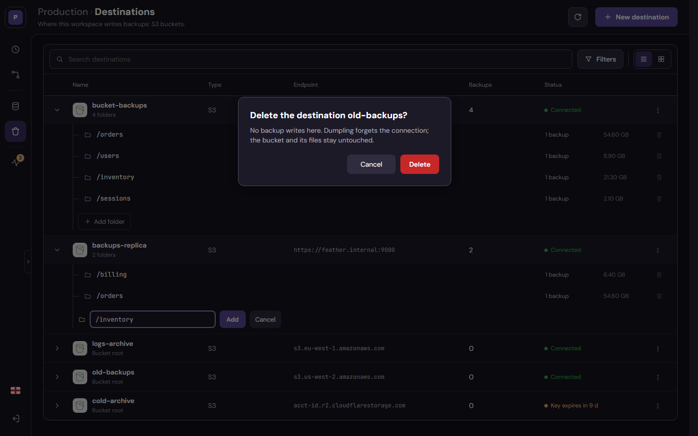

The detail shows the backups that write to each folder, the last check and the connection:

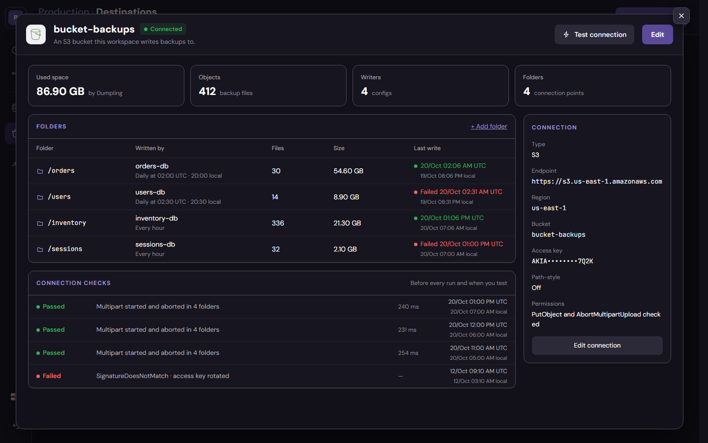

**Behind it:**

| Action                              | Call                                                                                                          |
|-------------------------------------|---------------------------------------------------------------------------------------------------------------|
| The types of the first step         | [`GET /api/destination-types`](api.md#types-of-sources-and-destinations)                                                      |
| The list                            | [`GET /api/workspaces/{slug}/destinations`](api.md#list-destinations)                                         |
| Test the form, before saving        | [`POST /api/workspaces/{slug}/destinations/test`](api.md#test-a-destination-before-saving) (`?destination={id}` editing: the saved secret key) |
| Create                              | [`POST /api/workspaces/{slug}/destinations`](api.md#create-a-destination)                                     |
| Edit, add or delete a folder        | [`PUT /api/workspaces/{slug}/destinations/{id}`](api.md#edit-a-destination)                                 |
| Test a saved one                    | [`POST /api/workspaces/{slug}/destinations/{id}/test`](api.md#test-a-saved-destination)                       |
| Delete                              | [`DELETE /api/workspaces/{slug}/destinations/{id}`](api.md#delete-a-destination)                              |
| The backups of the detail           | [`GET /api/workspaces/{slug}/configs`](api.md#list-configs)                                                   |

## Run log

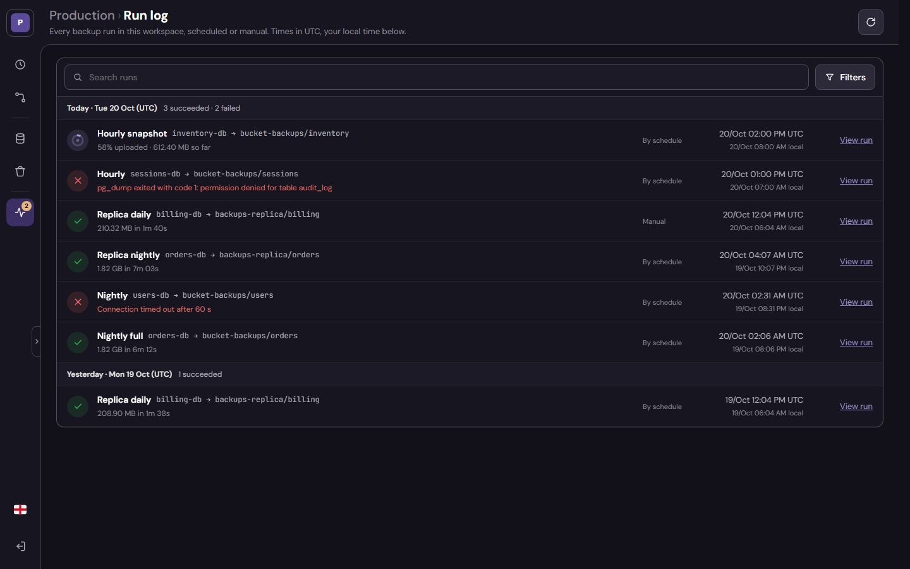

**URL:** `/#/workspaces/{slug}/runs` (`?status=` `running`, `success` or `failed`, `?source=` and
`?destination=` a type, like `postgres` or `s3`); a run: `/#/workspaces/{slug}/runs/{id}`

Every run of the workspace, newest first and grouped by day: the backup, its source and
destination, how it was started (its schedule or Run now), when, how long it took, its size and
its status. A search, and filters by status, source type and destination type, which go in the URL
so a filtered log can be shared:

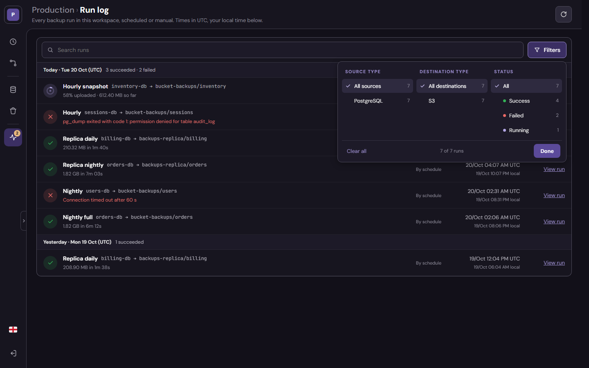

A run opens its details: its steps (connect, dump, upload), where the file went, its size and
duration, the error of a failed one, and its log, which can be copied. The password of a source
never appears in it.

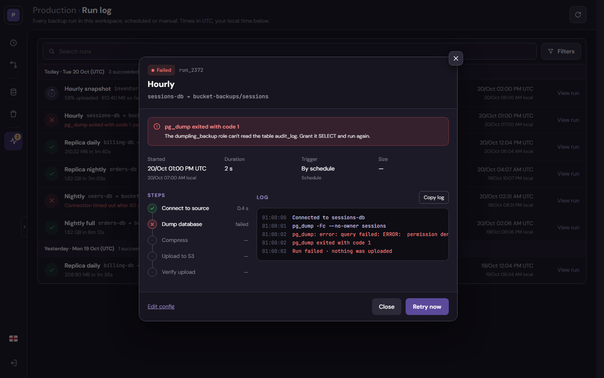

|                                                      |                                                          |
|------------------------------------------------------|----------------------------------------------------------|
| 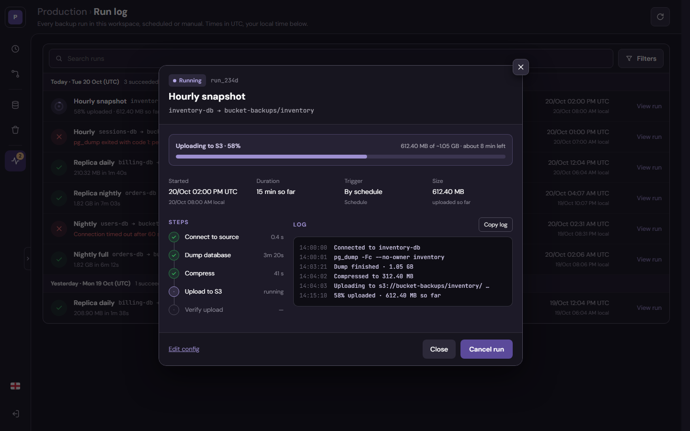 | 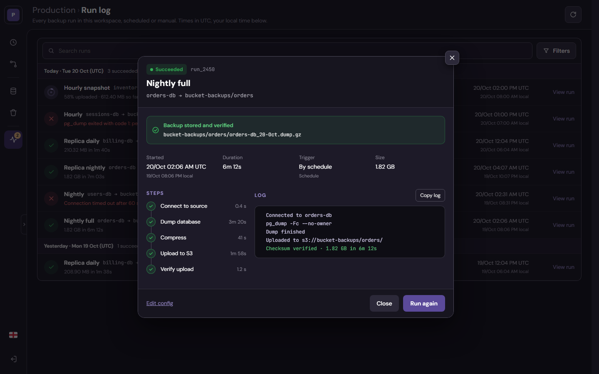 |
| **In progress**: the step it is on and the bytes uploaded so far | **Succeeded**: where the file went, to restore it |

To restore a backup, see [`restore.md`](restore.md).

**Behind it:** [`GET /api/workspaces/{slug}/runs`](api.md#run-log) for the log (the 200 newest,
without their log lines) and [`GET /api/workspaces/{slug}/runs/{id}`](api.md#a-run-and-its-log) for a run, with
its log.

## Loading and errors

Each screen loads as a skeleton of itself:

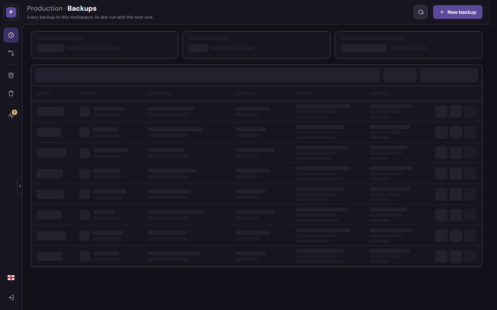

|                                                      |                                                          |
|------------------------------------------------------|----------------------------------------------------------|
| 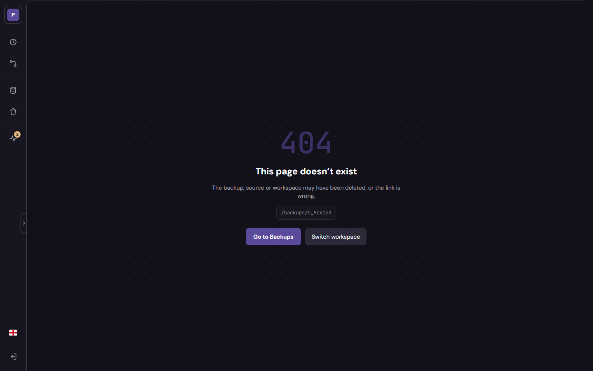        | 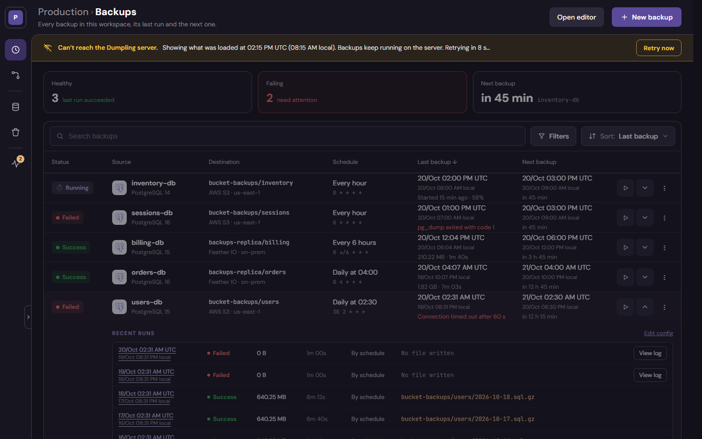 |
| **Not found**: an unknown URL or workspace, with the way back to the workspaces; an unknown id shows a notice over its screen instead | **Connection lost**: the service doesn't answer; it names the service's address and tries again |
