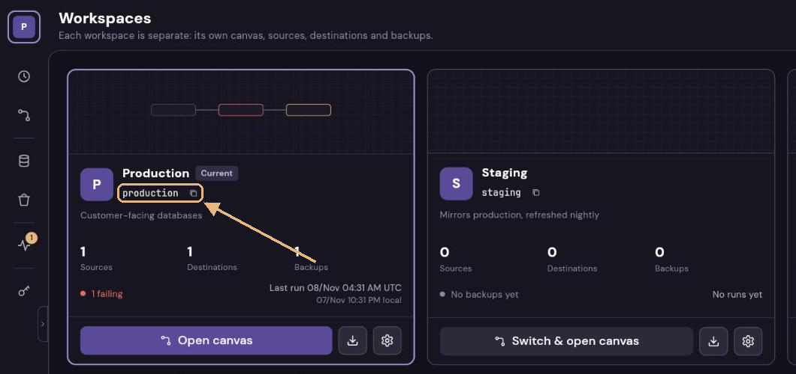
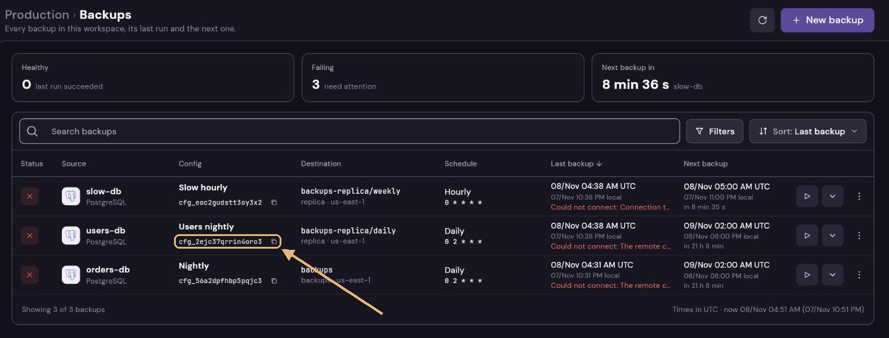
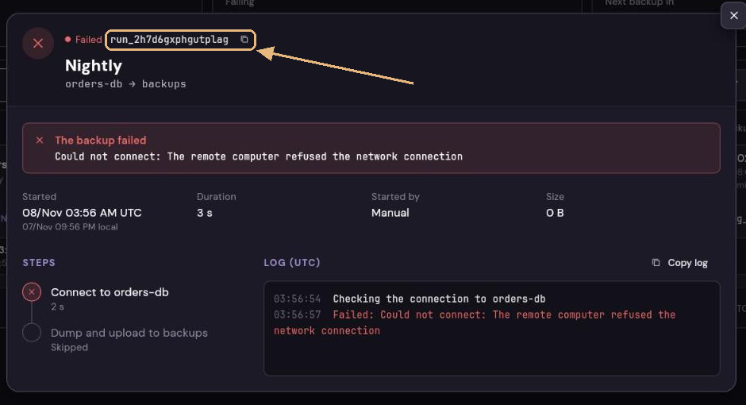

# Integrations

Other systems use Dumpling through its API with an **API key** of a workspace: a deploy pipeline
that backs up its database before running a migration, a script, a dashboard that reads the run
log. This guide shows the most common one, a backup before a deploy; the whole API is in
[`api.md`](api.md).

## 1. Create a key

In the console, **API keys** in the rail of the workspace, then **New API key**:

- **Name:** what uses it (`deploy-key`). The run log shows it on the runs it starts.
- **Access:** *Run backups* is enough for a pipeline: it starts backups and follows their runs.
  The permissions can also be marked one by one; each one says what it allows. The least this
  guide needs is `config.run` (start the backup) and `run.get` (follow it).
- **Only some configs:** limit it to the backup of the database the pipeline deploys. It runs only
  those configs and sees only their runs, and can't create configs nor use the canvas. The switch
  is off while the key has no permission on configs or runs: there is nothing for it to limit.

The key (`dmp_…`) is shown once: copy it into a secret of your pipeline (`DUMPLING_KEY`). Keys
don't expire; to renew one, create another and delete the old one.

The key, limited to a single config, already shows a `curl` with that config's id. The script
needs two more values, both shown in the console with a button to copy them (⧉):

- **`DUMPLING_WORKSPACE`**, the slug of the workspace: under its name in **Workspaces**, and in
  the address bar on any screen of it (`/#/workspaces/production/backups` → `production`).

  

- **`DUMPLING_CONFIG`**, the id of the config (`cfg_…`): in **Backups**, under the name of the
  config in its row; *Copy config id* in the row's menu (⋮) copies it too, and the dialog of the
  config shows it in a tag beside its name.

  

  Or ask the key itself, if it has `config.list` (*Run backups* has it): it lists the configs it
  reaches, with their names.

  ```sh
  curl -s https://dumpling.example.com/api/workspaces/production/configs \
    -H "Authorization: Bearer $DUMPLING_KEY" | jq -r '.[] | "\(.id)  \(.name)"'
  ```

The id of a run (`run_…`), what the script prints, is in its details, also with a button to copy
it: to find it later in the run log or follow it with [`…/runs/{id}/events`](api.md#follow-a-run).



## 2. Start a backup and wait for it

A script the pipeline runs before the migration (`scripts/backup-before-deploy.sh`). It needs
`curl` and `jq`, both in the GitHub and GitLab runners:

```sh
#!/bin/sh
# Backs up the database before a migration: fails, and stops the deploy, if the backup fails.
# Needs DUMPLING_URL, DUMPLING_WORKSPACE, DUMPLING_CONFIG and DUMPLING_KEY; VERSION is optional.
set -eu
api="$DUMPLING_URL/api/workspaces/$DUMPLING_WORKSPACE"
body='{}'
[ -n "${VERSION:-}" ] && body="{\"label\": \"$VERSION\"}"

started=$(curl -fsS -X POST "$api/configs/$DUMPLING_CONFIG/run" \
  -H "Authorization: Bearer $DUMPLING_KEY" \
  -H "Content-Type: application/json" \
  -d "$body")
run=$(echo "$started" | jq -r .id)
echo "Backup $run started"

# Follows the run until it ends (at most an hour); the event "end" carries the run as it ended
end=$(curl -sSN --max-time 3600 "$api/runs/$run/events" \
  -H "Authorization: Bearer $DUMPLING_KEY" | sed -n '/^event: end/{n;s/^data: //p;q;}')

if [ "$(echo "$end" | jq -r .status 2>/dev/null)" != success ]; then
  echo "Backup $run did not succeed: $(echo "$end" | jq -r '.error // "no answer"' 2>/dev/null)" >&2
  exit 1
fi
echo "Backup $run done: $(echo "$end" | jq -r .location)"
```

What it prints:

```text
Backup run_nbidsrjcovt6fvxu started
Backup run_nbidsrjcovt6fvxu done: backups/orders/2026-11-08-run_nbidsrjcovt6fvxu.dump.gz
```

```text
Backup run_7fhp2eiukievqaio started
Backup run_7fhp2eiukievqaio did not succeed: Could not connect: password authentication failed for user "dumpling_backup"
```

- **The label** (`$VERSION`, a tag or a commit: letters, digits, `.`, `_` or `-`, up to 64) names
  the run in the run log: *API · deploy-key* with `v1.4.2` under it, and the search finds it, so the
  backup of before each version is easy to find.
- **A backup already running:** the run waits its turn (`queued`) and starts when that one ends, so
  the backup is always from right before the migration.
- **The events** come as [Server-Sent Events](api.md#follow-a-run): one with the run as it changes,
  and `end` with the run when it finishes. A comment every 15 s keeps proxies from closing the
  connection. If it drops, the script fails without knowing how the backup ended: the run goes on,
  and the run log (or [`GET …/runs/{id}`](api.md#a-run-and-its-log)) says how it ended.

## 3. In the pipeline

In GitHub Actions, a step before the migration. The URL and the workspace are variables of the
repository, the key a secret:

```yaml
name: Deploy
on:
  push:
    tags: ["v*"]

jobs:
  deploy:
    runs-on: ubuntu-latest
    steps:
      - uses: actions/checkout@v4

      - name: Back up the database
        env:
          DUMPLING_URL: ${{ vars.DUMPLING_URL }}             # https://dumpling.example.com
          DUMPLING_WORKSPACE: ${{ vars.DUMPLING_WORKSPACE }} # production
          DUMPLING_CONFIG: ${{ vars.DUMPLING_CONFIG }}       # cfg_b2n23owtlcev45ue
          DUMPLING_KEY: ${{ secrets.DUMPLING_KEY }}
          VERSION: ${{ github.ref_name }}                     # v1.4.2
        run: sh scripts/backup-before-deploy.sh

      - name: Migrate
        run: ./scripts/migrate.sh   # runs only if the backup succeeded

      # … the deploy
```

In GitLab CI, the same with the variables in *Settings › CI/CD › Variables* (the key masked):

```yaml
backup:
  stage: .pre
  image: alpine:3.20
  variables:
    VERSION: $CI_COMMIT_TAG
  script:
    - apk add --no-cache curl jq
    - sh scripts/backup-before-deploy.sh
```

## When it fails

`curl` prints the status of a request the service refused, and the script stops there:

| Status | Why                                                                                    |
|--------|----------------------------------------------------------------------------------------|
| `401`  | The key is wrong or was deleted. Ten in a row lock the runner's IP for a while.         |
| `403`  | The key lacks the permission (`config.run` to start, `run.get` to follow), or the URL is of another workspace. |
| `404`  | The config doesn't exist, or the key is limited to other configs.                        |
| `422`  | `VERSION` isn't a valid label: letters, digits, `.`, `_` or `-`, up to 64.               |

A backup that started and failed ends the script with the error of the run: the database or the
storage refused it. The run log of the console has the run with its whole log.

## Basic auth

Tools that only take a user and a password can use the key that way: the user is the key's id
(`key_…`, in the list of keys) and the password the part of the key after its second `_`.

```sh
curl -u "key_7h2k9q4mxcd5fe3a:4fKq9ZtR2wLx8NvB1cHs6YpJ0eMa3UdG" \
  https://dumpling.example.com/api/workspaces/production/runs?trigger=api
```

## What a key can't do

A key reaches only its workspace and the permissions it was given; never the admin's session, other
workspaces, export, import or the keys themselves. A wrong key is a `401` and counts as a failed
login of its IP. Deleting a key cuts it at its next request; the runs it started stay in the run
log. More in [`SECURITY.md`](../SECURITY.md).
